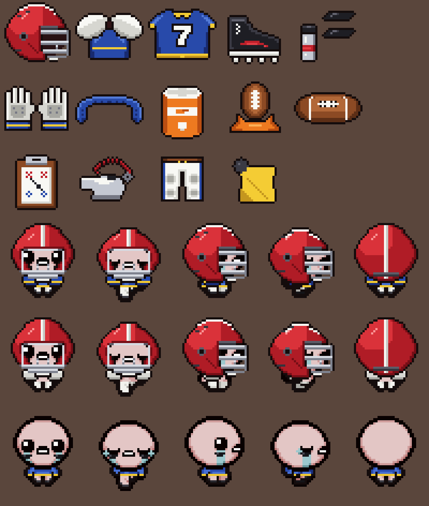

# Gridiron

A mod for **The Binding of Isaac: Repentance+** (all DLC) that adds American football gear.
None of the items replaces a vanilla item, and none is just cosmetic: each one has its own mechanic.
It uses only the vanilla Lua API, so REPENTOGON is **not** required.



## Items

| Item | Type | Pools | What it does |
|---|---|---|---|
| **Football Helmet** | Passive (Q3) | Treasure | **Tackle:** run in a straight line for ~1s and Isaac starts glowing. Running into enemies then deals 3× damage + 5, knocks them back hard, confuses them and **stuns** them (the chin strap is built in). You take no contact damage while tackling. **Facemask:** 50% chance to block enemy shots that hit you from the direction you're facing. |
| **Shoulder Pads** | Passive (Q2) | Treasure, Shop | 25% chance to **deflect** enemy shots back so they hit enemies. Taking damage sets off a **shockwave** that shoves enemies away and destroys nearby shots. With the Helmet, every tackle also sets off a smaller shockwave. |
| **Team Jersey** | Passive (Q2) | Treasure, Golden Chest | You get a **jersey number** (1–99) for the run. Every N shots (N = 3–9, set by your number) you throw a spiraling **football**: 2× damage, piercing, spectral. **Pre-snap:** enemies freeze briefly when you enter a room. |
| **Football Cleats** | Passive (Q2) | Treasure, Shop | +0.2 Speed. Running **10 yards** in an uncleared room earns a **First Down**: +0.5 Damage until you leave the room (max 4 per room). |
| **Eye Black** | Passive (Q2) | Treasure, Shop | +1 Luck. Tears do up to **+50% damage the farther they travel**. Makes you immune to **Curse of Darkness**. |
| **Padded Pants** | Passive (Q2) | Treasure, Shop | 30% chance to **shrug off** damage from touching an enemy and **stiff-arm** it away. Extra copies stack (up to 60%). |
| **QB Wristband** | Passive (Q2) | Treasure, Shop | +0.16 Shot speed. **Every football you throw** (Jersey, Gloves, Trick Play, the Quarterback...) **homes in** and deals **+25% damage**. |
| **Foam Finger** | Passive (Q2) | Treasure, Shop | The toughest enemy in each room is marked **#1**: you deal +50% damage to it, and it drops a penny when it dies. |
| **Super Bowl Ring** | Passive (Q3) | Treasure, Boss | +1 Luck. Every **boss room** you clear adds a ring: +0.35 Damage for the rest of the run. |
| **Receiver Gloves** | Passive (Q2) | Treasure | When you're **not shooting**, 35% chance to **catch** an enemy shot instead of getting hit (hold up to 3, shown above your head). Each shot you fire throws one caught ball back as a **football**: 1.5× damage, piercing, spectral. |
| **Mouthguard** | Passive (Q2) | Treasure, Shop | The **first hit each room** that deals a full heart or more deals **half a heart less**. Makes you immune to **fear** and **confusion**. |
| **Kicking Tee** | Active, 4 charges | Treasure | **Punt** a football in the direction you're aiming. It sails over rocks and pits and **explodes on landing** for 40 + 4× your damage, without hurting you. If the blast kills an enemy, that's a **field goal: 3 pennies**. |
| **Pigskin** | Active, 3 charges | Treasure, Shop | Throw a **fumble** that stays on the ground for 5 seconds. Non-boss enemies **scramble toward it** and get confused. **Recover it** for a **Touchdown**: +1 Damage until you leave the room. |
| **Playbook** | Active, 2 charges | Treasure | **Call a play** for the room. Each use turns to the next page: **Blitz** (tears up, +0.3 speed) → **Hail Mary** (+range, +shot speed, piercing tears) → **Trick Play** (your next 6 shots are footballs). |
| **Coach's Whistle** | Active, 4 charges | Treasure, Boss | **Offsides!** Shoves every enemy away from you and slows them for 5 seconds, and wipes out all enemy shots. Bosses take damage instead of being shoved. |
| **End Zone** | Active, 4 charges | Treasure | **Paints an end zone** on the floor for the room. Standing in it gives **+1.5 Damage**; enemies inside it are **slowed**. A Pigskin **touchdown scored in it counts double**. |
| **Gatorade Bucket** | Passive (Q2) | Treasure, Shop | Clearing a room **without getting hit** fills the bucket. Every 3 fills (or one no-hit boss room) you get a **Gatorade shower**: heal a full red heart, or half a soul heart if your red hearts are full. |
| **Concussion Protocol** | Trinket | Trinket pool | Taking damage **confuses every enemy** in the room for 2 seconds. |
| **Turf Burn** | Trinket | Trinket pool | **Sprinting scorches the turf** behind you: the burning creep damages enemies. Tackled enemies get a big scorch mark. |
| **Referee Flag** | Trinket | Trinket pool | **Flag on the play:** when an enemy or its shot hits you, that enemy takes 10 + 3× floor-number damage and is slowed. |

### Set bonus: Suited Up
Hold **3 or more** of the nine wearable gear items (Helmet, Pads, Jersey, Cleats, Eye Black, Gloves, Mouthguard, Padded Pants, QB Wristband) to get **Suited Up**: +1 Damage, the Helmet's tackle winds up twice as fast, and you pulse gold.

### Familiars
| Item | Quality | Pools | What it does |
|---|---|---|---|
| **Cheerleader** | Q2 | Treasure | Follows you. Every 6 kills she runs a routine: **+33% fire rate for 5 seconds** ("GO TEAM!"). |
| **Water Boy** | Q1 | Treasure, Shop | Follows you. 33% chance (better with Luck) to drop **half a red heart** after a cleared room, always after a boss. With the **Gatorade Bucket**, clean rooms fill it twice as fast. |
| **Tackling Dummy** | Q2 | Treasure | Orbits you, **blocks enemy shots** and **pulls nearby enemies** onto itself. |

### Pocket items
| Item | Type | What it does |
|---|---|---|
| **Coin Toss** | Card | Flip a coin. **Heads:** +1.5 Damage for the room. **Tails:** fully recharges your active item and slows every enemy. |
| **Timeout!** | Pill | Freezes every enemy for 3 seconds, clears enemy shots, and heals half a heart. |

## Base-game synergies

| Gridiron item | With | Effect |
|---|---|---|
| Football Helmet | Mars | Every dash is a tackle |
| Football Helmet | Aries, Taurus | Tackles go live twice as fast |
| Football Helmet | Leo, Thunder Thighs, Magic Mushroom, Bucket of Lard | Tackles deal +25% damage and knock enemies 50% farther |
| Receiver Gloves | Magneto, Telekinesis | +20% catch chance |
| Shoulder Pads | Infamy | +15% deflect chance |
| Team Jersey / The Quarterback | Brimstone, Technology, Mom's Knife, Epic Fetus, the Forgotten's bone, ... | Still throw a football every few attacks |
| Kicking Tee | Ipecac, Dr. Fetus, Epic Fetus, Bomber Boy, Mr. Mega | +50% blast radius |
| Pigskin | Strange Attractor, Magneto | Pulls enemies twice as hard, from twice as far |
| Gatorade Bucket | Holy Water, Free Lemonade, Lemon Mishap, Ball of Tar, Juicy Sack | The shower leaves matching creep |
| Cheerleader / Water Boy / Tackling Dummy | BFFS! | Stronger routines / more hearts / wider pull |
| Football Cleats | Pony, White Pony, Taurus | First downs need half the yards |
| Padded Pants | Thunder Thighs, Leo | +15% shrug-off chance |
| Super Bowl Ring | Money = Power, Greed's Gullet | Rings give double damage |
| Foam Finger | Marked, Eye of the Occult | +100% damage to the #1 enemy (instead of +50%) |
| QB Wristband | Spoon Bender, Godhead, Sacred Heart | Footballs deal another +25% |
| Coin Toss | Tarot Cloth | The coin lands on its edge: you get heads **and** tails |
| Turf Burn | Football Cleats | Scorch marks last twice as long |
| Every football | Tear effects (fire, poison, Ipecac, holy light, ice, charm, Dark Matter, Midas, homing) | The football takes on that effect's colour, so you can see the synergy |

These also appear in External Item Descriptions.

## Playable character: The Quarterback
| Version | Health | Starts with | Play style |
|---|---|---|---|
| **The Quarterback** | 3 red hearts | Football Helmet, Team Jersey, **Playbook** (pocket active) | Every 3rd shot is a football, and all his footballs fly 25% faster and hit 25% harder. +0.2 shot speed. **Birthright:** every other shot is a football. |
| **Tainted Quarterback** | 2 red + 1 soul | Football Helmet, Shoulder Pads, **Kicking Tee** (pocket active) | Throws **only footballs**: much slower fire rate, but each one hits hard. **Birthright:** footballs home in on enemies. |

Both appear on the character select screen with their own page, portrait, co-op and death-screen art.

## Boss & enemies
| Entity | Where | What it does |
|---|---|---|
| **The Linebacker** (boss) | May replace Monstro, Gurdy, Gurdy Jr., Duke of Flies or Dingle on floors 2–6 (25%) | Walks you down, then either **telegraphs a charge** (crouches and flashes) and blitzes across the room, getting **stunned** if he hits a wall, or **spikes a football** that bursts into shots. Below half health he enrages: faster, plus a **pile-up jump** that lands with a ring of shots. |
| **Mascot** | Sometimes replaces a Gaper, Horf or Clotty (8%) | Waddles toward you and fires big, slow **T-shirt cannon** shots. |
| **Referee** | Sometimes replaces a Gaper, Horf or Clotty (8%) | Keeps his distance, blows his whistle and **throws yellow flags** at you. |

Both chances can be changed (or set to 0) in the menu. When the Linebacker replaces a boss, the intro screen still shows the original boss.

## Challenges
Find these under **Challenges → Custom**:
| Challenge | Goal | Rules |
|---|---|---|
| **Fourth and Long** | Mom's Heart | Start Suited Up (Helmet, Pads, Jersey) with the Gatorade Bucket. Red hearts turn into pennies, so Gatorade showers are your only healing. |
| **Two-Minute Drill** | Mom | Start with the Playbook, Cleats and Eye Black. Each floor runs on a 2:00 game clock; every cleared room adds 10 seconds and recharges the Playbook. In overtime you lose half a heart every 15 seconds. |
| **Ground Game** | Mom | You can't shoot. Start with the Helmet, Pads, Cleats, Pants and Kicking Tee. Tackles deal double damage and wind up twice as fast. |

## Installing
1. Download `gridiron-vX.Y.Z.zip` from the [latest release](https://github.com/bulmaspanties/tboifbm/releases/latest).
2. Unzip it into your Isaac `mods` folder, so you end up with `mods/gridiron/metadata.xml`. On Steam/Windows that's
   `C:\Program Files (x86)\Steam\steamapps\common\The Binding of Isaac Rebirth\mods`.
3. Launch the game and turn on **Gridiron** in the Mods menu.
4. To try everything at once, open the debug console (`~`) and type `gridiron give` and walk over the pedestals.

### Publishing to the Steam Workshop
The release zip is already laid out the way the Workshop uploader wants: one `gridiron/` folder with
`metadata.xml` (name, BBCode description, tags, version, visibility), `thumb.png` (the 512×512 preview) and only
the files the game loads. No build tools or tests ship in it.

1. Unzip the release into the game's `mods` folder, so you have `mods/gridiron/metadata.xml`.
   Launch the game once with the mod enabled to check it loads.
2. Run **ModUploader.exe** from the game's `tools/ModUploader` folder
   (`steamapps/common/The Binding of Isaac Rebirth/tools/ModUploader`), pick **gridiron** and upload.
   It fills in the name, description, tags and preview from the folder. Add a change note (copy the newest CHANGELOG entry).
3. `metadata.xml` ships with `<visibility>Private</visibility>`, so the first upload is only visible to you.
   Subscribe to it on another profile or check the page, then switch it to **Public** on the Workshop page (or in the file) when you're ready.
4. After the first upload the uploader writes the Workshop `<id>` into `mods/gridiron/metadata.xml`.
   **Copy that `<id>` line into the repo's `metadata.xml`**: every later upload then updates the same Workshop page instead of making a new one.
5. If the uploader rejects a tag, delete that `<tag>` line and upload again.

To update: bump `<version>`, build the zip, unzip it over `mods/gridiron` (keep the `<id>`), and run the uploader again.

### Making a release
Bump `<version>` in `metadata.xml` and push to `main`, then run the **Release** workflow from the Actions tab (or push a matching `v*` tag).
The Release workflow runs the smoke test, builds the zip with `tools/package.py` and publishes it.

If **External Item Descriptions** is installed, every item shows its description (numbers follow your settings).

## Settings menu
Gridiron adds a page to the **Dead Sea Scrolls** menu (press **C** in a run, or the key you've set):
- **gameplay:** tackle windup, facemask block %, pad deflect %, glove catch %, pants shrug-off %, yards per first down, kick damage, Linebacker boss chance, football-enemy chance, reset to defaults
- **visuals:** costumes on/off, Suited Up glow, HUD text (down & distance, current play, bucket fill), popup text (callouts like TACKLE!, IT'S GOOD!, FUMBLE!)
- **uniform:** pick your team colours: **helmet** shell, **jersey** (the trim and sleeve stripes match) and **pants**, ten colours each (red, blue, navy, green, orange, purple, gold, black, silver, white); **team defaults** puts back the red/blue/white uniform
- **costume fit:** hide the helmet, eye black, jersey/pads or pants/cleats for the character you're playing right now

Settings are saved and kept between runs. Your run state (caught balls, bucket, jersey, current play…) also survives **save & continue**.

## Console commands
Open the debug console with `~`:
| Command | What it does |
|---|---|
| `gridiron give` | Drops every item as a pedestal. Walk over them: picking an item up is what adds it to your collection and the pause screen's *My Stuff* list |
| `gridiron give quick` | Gives every passive instantly (they show as "?" in *My Stuff* until you find them for real); drops actives and trinkets |
| `gridiron boss` / `gridiron enemies` | Spawn the Linebacker, or a Mascot and a Referee, next to you |
| `gridiron hide <slot>` / `gridiron show <slot>` | Hide/show a costume piece for your current character (`helmet`, `eyeblack`, `torso`, `legs`) |
| `gridiron reset` | Reset all settings to defaults |

## Costumes
Your character wears what you pick up: the helmet (with facemask) and eye black on the head, jersey and/or shoulder pads on the torso, and pants and/or cleats on the legs.
All costumes are managed in Lua, so they can be turned off, hidden per character, and are re-applied after anything that resets costumes.
They're drawn on Isaac's body shape. If a piece looks wrong on another character, hide it from **costume fit** in the menu (or `gridiron hide <slot>`), and send a screenshot so it can get a proper fix.

## Layout
```
metadata.xml                    mod manifest
main.lua                        loads the scripts below
scripts/core.lua                item ids, tuning (Cfg), settings, shared helpers
scripts/gear.lua                passive items, trinkets, stats
scripts/actives.lua             Kicking Tee, Pigskin, Playbook, Coach's Whistle
scripts/costumes.lua            worn gear (null costumes, per-character hiding)
scripts/hud.lua                 Suited Up glow, held balls, text readouts
scripts/save.lua                settings + save & continue persistence
scripts/eid.lua                 External Item Descriptions
scripts/menu.lua                Dead Sea Scrolls settings page
scripts/commands.lua            `gridiron` console commands
scripts/dssmenucore.lua         Dead Sea Scrolls library (public domain, unmodified)
content/                        items, pools, costumes, sounds
resources/gfx/...               item sprites, costumes, football tear, DSS menu art
resources/sfx/...               referee whistle, DSS menu sounds
tests/smoke_test.lua            runs the mod against a mock of the Isaac API
tools/make_sprites.py           renders item/tear sprites from pixel maps (needs Pillow)
tools/make_costumes.py          generates costume sheets + .anm2 on Isaac's rig (needs Pillow)
tools/make_sounds.py            synthesizes the referee whistle (stdlib only)
tools/make_entities.py          familiar, enemy and boss sprites + anm2 (needs Pillow)
tools/make_character.py         the Quarterback's sheets and menu art (needs Pillow + the CC0 template)
tools/package.py                builds the release zip
```

## Credits
- Character menu layouts and the base player sheet come from the CC0 [IsaacTemplates](https://github.com/manaphoenix/IsaacTemplates) character template (recolored and redrawn by `tools/make_character.py`).
- Costume rig reference: [isaac-costume-templates](https://github.com/catinsurance/isaac-costume-templates).
- Settings menu: [Dead Sea Scrolls](https://github.com/Meowlala/DeadSeaScrollsMenu) (public domain).

## Testing
`tests/smoke_test.lua` loads `main.lua` against a mock of the game's Lua API and runs every item through its callbacks.
It also checks that item names, costume paths and sprite/animation paths match the XML and the files on disk.
Run it from the repo root with Lua 5.3 or newer:
```
lua tests/smoke_test.lua
```
It catches typos, nil errors and broken wiring. Balance and game feel still need a real playtest.

## Roadmap
- Playtest and balance pass
- Per-character costume fixes (send screenshots of anything that looks off)
