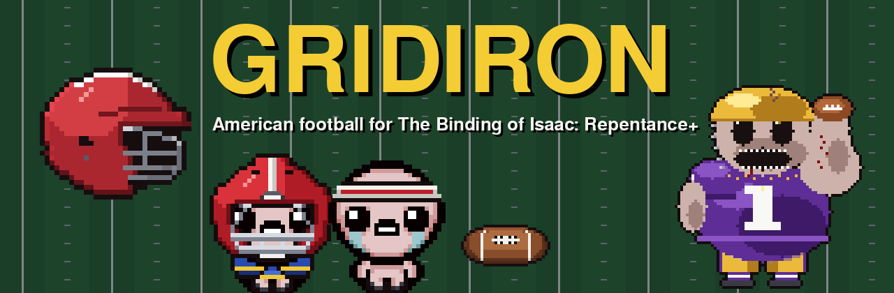
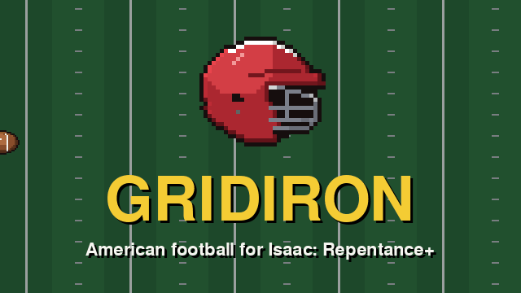
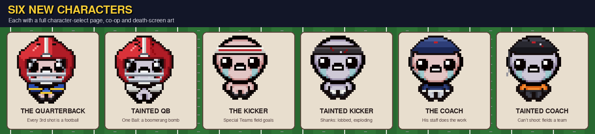
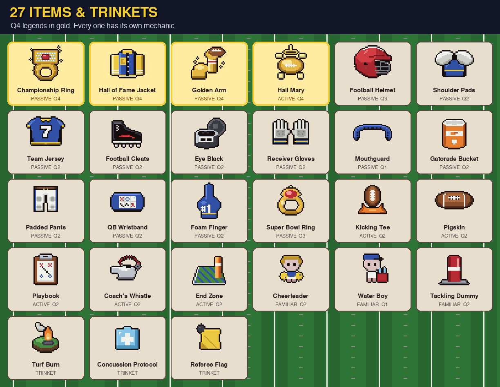
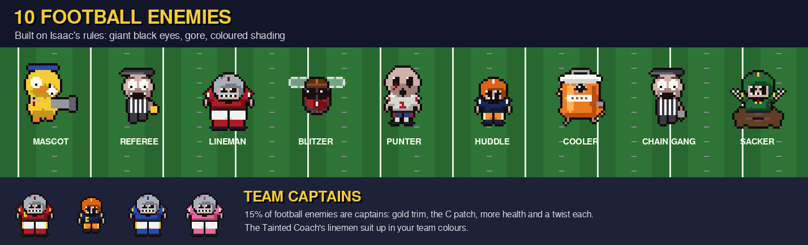
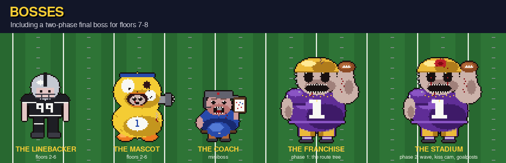
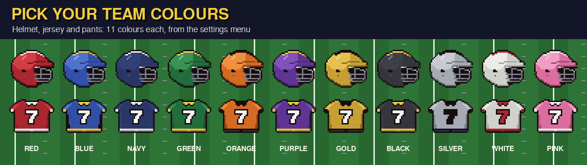
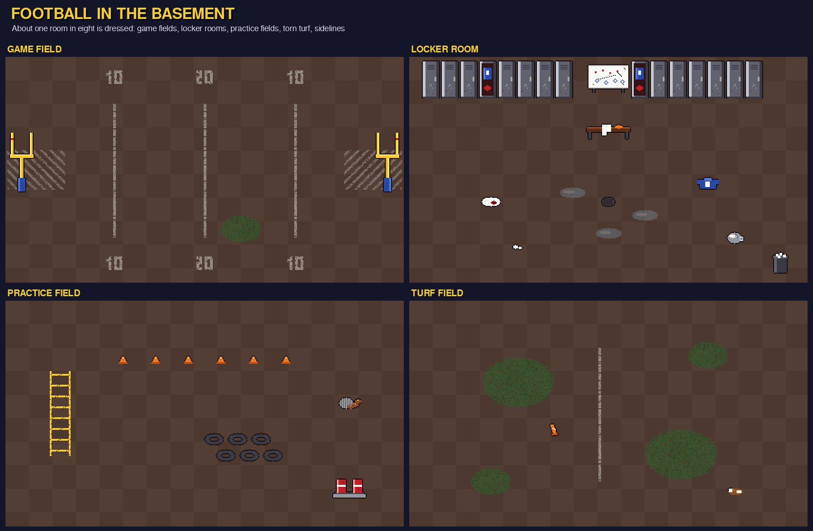

<p align="center"></p>

<p align="center">
  <a href="https://github.com/bulmaspanties/tboifbm/releases/latest"></a>
  
  
</p>

<p align="center"></p>

**Gridiron** suits Isaac up for football. Every item is real gear with its own mechanic: no reskins, no stat-only filler, nothing replaced.
Tackle with the helmet, deflect with the pads, catch with the gloves, punt with the tee, and when you're wearing three pieces you're **Suited Up**.
Then take on a rival Linebacker, a giant Mascot, a stadium full of grotesque football enemies, and **The Franchise**.

**[⬇ Download the latest release](https://github.com/bulmaspanties/tboifbm/releases/latest)**, unzip it into your `mods` folder, and enable **Gridiron**.

## Highlights
- **27 items and trinkets**: wearable gear, actives, familiars, and four **Q4 legends** (Championship Ring, Hall of Fame Jacket, Golden Arm, Hail Mary)
- **Six characters**: The Quarterback, The Kicker and The Coach, plus tainted versions that play completely differently
- **Three bosses, a miniboss and 10 football enemies** in Isaac's own grotesque style, every player in full kit (pads under the jersey, pants, socks, cleats), with **Team Captain** champions
- **Worn costumes** fitted per character (roomy helmets for big hair, horn holes for horns), in **11 team colours**, pink included
- **All-Pro** transformation, a **Halftime show** event, **completion notes**, and dozens of **base-game synergies**
- **Football in the basement**: some rooms are dressed with faded field paint, sideline junk, goalposts and benches
- **Juiced**: steroids make tackles brutal (enemies pinball into each other), but the referees run drug tests
- **Boss themes** for the Linebacker, The Mascot and The Franchise: marching drumlines, brass, organ and a dark choir
- **Stadium sounds**, a settings menu (press **C**), External Item Descriptions support, and save & continue

<p align="center"></p>
<p align="center"></p>
<p align="center"></p>
<p align="center"></p>
<p align="center"></p>
<p align="center"></p>

## Everything in detail
Click a section to expand it.

<details>
<summary><b>Items</b></summary>

## Items
| Item | Type | Pools | What it does |
|---|---|---|---|
| **Football Helmet** | Passive (Q3) | Treasure | **Tackle:** run in a straight line for ~1s and Isaac starts glowing. Running into enemies then deals 3× damage + 5, knocks them back hard, confuses them and **stuns** them (the chin strap is built in). You take no contact damage while tackling. **Facemask:** 40% chance to block enemy shots that hit you from the direction you're facing. |
| **Shoulder Pads** | Passive (Q2) | Treasure, Shop | 25% chance to **deflect** enemy shots back so they hit enemies. Taking damage sets off a **shockwave** that shoves enemies away and destroys nearby shots. With the Helmet, every tackle also sets off a smaller shockwave. |
| **Team Jersey** | Passive (Q2) | Treasure, Golden Chest | You get a **jersey number** (1–99) for the run. Every N shots (N = 3–9, set by your number) you throw a spiraling **football**: 2× damage, piercing, spectral. **Pre-snap:** enemies freeze briefly when you enter a room. |
| **Football Cleats** | Passive (Q2) | Treasure, Shop | +0.2 Speed. Running **10 yards** in an uncleared room earns a **First Down**: +0.5 Damage until you leave the room (max 4 per room). |
| **Eye Black** | Passive (Q2) | Treasure, Shop | +1 Luck. Tears do up to **+50% damage the farther they travel**. Makes you immune to **Curse of Darkness**. |
| **Padded Pants** | Passive (Q2) | Treasure, Shop | 30% chance to **shrug off** damage from touching an enemy and **stiff-arm** it away. Extra copies stack (up to 60%). |
| **QB Wristband** | Passive (Q2) | Treasure, Shop | +0.16 Shot speed. **Every football you throw** (Jersey, Gloves, Trick Play, the Quarterback...) **homes in** and deals **+25% damage**. |
| **Foam Finger** | Passive (Q2) | Treasure, Shop | The toughest enemy in each room is marked **#1**: you deal +50% damage to it, and it drops a penny when it dies. |
| **Super Bowl Ring** | Passive (Q3) | Treasure, Boss, Golden Chest | +1 Luck. Every **boss room** you clear adds a ring: +0.35 Damage for the rest of the run. |
| **Receiver Gloves** | Passive (Q2) | Treasure | When you're **not shooting**, 35% chance to **catch** an enemy shot instead of getting hit (hold up to 3, shown above your head). Each shot you fire throws one caught ball back as a **football**: 1.5× damage, piercing, spectral. |
| **Mouthguard** | Passive (Q1) | Treasure, Shop | The **first hit each room** that deals a full heart or more deals **half a heart less**. Makes you immune to **fear** and **confusion**. |
| **Kicking Tee** | Active, 4 charges | Treasure | **Punt** a football in the direction you're aiming. It sails over rocks and pits and **explodes on landing** for 40 + 4× your damage, without hurting you. If the blast kills an enemy, that's a **field goal: 3 pennies**. |
| **Pigskin** | Active, 3 charges | Treasure, Shop | Throw a **fumble** that stays on the ground for 5 seconds. Non-boss enemies **scramble toward it** and get confused. **Recover it** for a **Touchdown**: +1 Damage until you leave the room. |
| **Playbook** | Active, 2 charges | Treasure, Library (counts toward Book Worm) | **Call a play** for the room. Each use turns to the next page: **Blitz** (tears up, +0.3 speed) → **Hail Mary** (+range, +shot speed, piercing tears) → **Trick Play** (your next 6 shots are footballs). |
| **Coach's Whistle** | Active, 4 charges | Treasure, Boss, Crane Game | **Offsides!** Shoves every enemy away from you and slows them for 5 seconds, and wipes out all enemy shots. Bosses take damage instead of being shoved. |
| **End Zone** | Active, 4 charges | Treasure | **Paints an end zone** on the floor for the room. Standing in it gives **+1.5 Damage**; enemies inside it are **slowed**. A Pigskin **touchdown scored in it counts double**. |
| **Gatorade Bucket** | Passive (Q2) | Treasure, Shop, Beggar | Clearing a room **without getting hit** fills the bucket. Every 3 fills (or one no-hit boss room) you get a **Gatorade shower**: heal a full red heart, or half a soul heart if your red hearts are full. |
| **Championship Ring** | Passive (**Q4**) | Treasure, Boss | **x1.25 Damage.** Beating each floor's boss spawns a **trophy**: an extra item from the boss pool. With the Super Bowl Ring, its rings are worth double. |
| **Hall of Fame Jacket** | Passive (**Q4**) | Treasure, Secret | A letterman jacket that **counts as 3 gear pieces**: instantly Suited Up, the Suited Up bonus is **doubled** (+2 Damage), and tackles go live **4x faster**. |
| **Golden Arm** | Passive (**Q4**) | Treasure, Devil | **Every shot is a golden football**: x1.5 damage, piercing, spectral. +0.3 Shot speed. |
| **Hail Mary** | Active (**Q4**), 6 charges | Treasure, Angel | Heaves a **giant golden football** across the room (8x damage + 30, piercing). Where it lands: a **beam of holy light** and a ring of 10 footballs. |
| **Concussion Protocol** | Trinket | Trinket pool | Taking damage **confuses every enemy** in the room for 2 seconds. |
| **Turf Burn** | Trinket | Trinket pool | **Sprinting scorches the turf** behind you: the burning creep damages enemies. Tackled enemies get a big scorch mark. |
| **Lucky Patch** | Trinket | Trinket pool | +1 Luck, and +2 more while **Suited Up**. |
| **Chin Strap Buckle** | Trinket | Trinket pool | Tackles go live **25% faster** and shove **bosses at full force**. |
| **Pylon** | Trinket | Trinket pool | Entering a room with enemies plants a **pylon at the far end**. Touch it before the room is clear: **+1 Damage** for the room. |
| **Game Coin** | Trinket | Trinket pool | Flips every floor. **Heads:** +0.5 Damage for the floor. **Tails:** +0.2 Speed for the floor. |
| **Mouth Tape** | Trinket | Trinket pool | Immune to **fear and confusion**, slightly faster tears. |
| **Hand Warmer** | Trinket | Trinket pool | **Stand still** a moment to warm up: your next shot is a **football that deals double damage**. |
| **Referee Flag** | Trinket | Trinket pool | **Flag on the play:** when an enemy or its shot hits you, that enemy takes 10 + 3× floor-number damage and is slowed. |

Every item also appears in the matching **Greed mode** pools, and every passive works with **Lemegeton**.

### Set bonus: Suited Up
Hold **3 or more** of the nine wearable gear items (Helmet, Pads, Jersey, Cleats, Eye Black, Gloves, Mouthguard, Padded Pants, QB Wristband) to get **Suited Up**: +1 Damage, the Helmet's tackle winds up twice as fast, and you pulse gold.

### Transformation: All-Pro
Hold **any 3 Gridiron items** (passives, actives, familiars, Q4s: anything from this mod) to become **All-Pro**, for the rest of the run like a vanilla transformation: **+0.5 Damage**, **every 4th shot is a homing golden spiral**, and your eye black turns to **gold war paint** (it shows through the facemask).

### Field decor
About one normal room in eight looks like somebody played football in it, and no two look alike:
- **Game field:** goalposts at both ends, end zones, yard lines and painted numbers.
- **Locker room:** a row of dented lockers along the wall (some hanging open), a whiteboard of plays, a bench, the shower drain and puddles, bloody towels and dropped jerseys.
- **Practice field:** a line of cones, a taped agility ladder, a tire drill, a sled and ball bags.
- **Turf field:** torn, filthy patches of old artificial turf laid over the floor.
- Or just a **sideline** down one wall, **end zone stripes** in a corner, **painted yard numbers**, a scrubbed **team logo**, or sideline junk (cups, stains, a tipped cooler, a busted pylon, a dented helmet, a bloody mouthguard).

The football bosses' rooms get **stadium banners**. Props never collide with anything or block a door, and each room looks the same every time you come back. Set **field decor** to off, light or full in *visuals*.

### Pro Shop
A quarter of shops (adjustable in the menu) are **team stores**: banners and lockers on the walls, and the first time you walk in, one item for sale is a **Gridiron item you don't have yet**, at the shop's price.

### Halftime show
Clearing a normal room has a **6% chance** (once per floor, adjustable in the menu) to start a **halftime show**: the whistle, the stadium horn, fireworks and the crowd. You get to **pick one**: a **Gridiron item you don't have yet** or a **soul heart**. Take one and the other disappears.

### Familiars
| Item | Quality | Pools | What it does |
|---|---|---|---|
| **Cheerleader** | Q2 | Treasure | Follows you. Every 6 kills she runs a routine: **+33% fire rate for 5 seconds** ("GO TEAM!"). |
| **Water Boy** | Q1 | Treasure, Shop | Follows you. 33% chance (better with Luck) to drop **half a red heart** after a cleared room, always after a boss. With the **Gatorade Bucket**, clean rooms fill it twice as fast. |
| **Tackling Dummy** | Q2 | Treasure | Orbits you, **blocks enemy shots** and **pulls nearby enemies** onto itself. |

### Pocket items
| Item | Type | What it does |
|---|---|---|
| **Coin Toss** | Card | Flip a coin. **Heads:** +1.5 Damage for the room. **Tails:** fully recharges your active item and slows every enemy. |
| **Audible** | Card | Every regular enemy in the room is **swapped for a football enemy** (confused for a moment). |
| **Fair Catch** | Card | Every enemy shot in the air **drops dead**, and you're safe for 2 seconds. With **Receiver Gloves**, you catch them all. |
| **Two-Point Conversion** | Pill | **+2** of whatever you have least of: coins, bombs or keys. |
| **Timeout!** | Pill | Freezes every enemy for 3 seconds, clears enemy shots, and heals half a heart. |

</details>

<details>
<summary><b>Base-game synergies</b></summary>

## Base-game synergies
| Gridiron item | With | Effect |
|---|---|---|
| Football Helmet | Mars | Every dash is a tackle |
| Football Helmet | Aries, Taurus | Tackles go live twice as fast |
| Football Helmet | Leo, Thunder Thighs, Magic Mushroom, Bucket of Lard | Tackles deal +25% damage and knock enemies 50% farther |
| Receiver Gloves | Magneto, Telekinesis | +20% catch chance |
| Shoulder Pads | Infamy | +15% deflect chance |
| Team Jersey / The Quarterback | Brimstone, Technology, Mom's Knife, Epic Fetus, the Forgotten's bone, ... | Still throw a football every few attacks |
| Kicking Tee | Ipecac, Dr. Fetus, Epic Fetus, Bomber Boy, Mr. Mega | +50% blast radius |
| Pigskin | Strange Attractor, Magneto | Pulls enemies twice as hard, from twice as far |
| Gatorade Bucket | Holy Water, Free Lemonade, Lemon Mishap, Ball of Tar, Juicy Sack | The shower leaves matching creep |
| Cheerleader / Water Boy / Tackling Dummy | BFFS! | Stronger routines / more hearts / wider pull |
| Football Cleats | Pony, White Pony, Taurus | First downs need half the yards |
| Padded Pants | Thunder Thighs, Leo | +15% shrug-off chance |
| Super Bowl Ring | Money = Power, Greed's Gullet | Rings give double damage |
| Foam Finger | Marked, Eye of the Occult | +100% damage to the #1 enemy (instead of +50%) |
| QB Wristband | Spoon Bender, Godhead, Sacred Heart | Footballs deal another +25% |
| Coin Toss | Tarot Cloth | The coin lands on its edge: you get heads **and** tails |
| Turf Burn | Football Cleats | Scorch marks last twice as long |
| Football Helmet | Roid Rage, Growth Hormones, Synthoil, Experimental Treatment | **Juiced**: tackles hit 50% harder and send enemies **pinballing** into each other; the tackle glow runs red. Referees and the Chain Gang notice: **drug tests** (flags twice as often, faster refs). Turn drug tests off in the menu. |
| Football Helmet | Knockout Drops | Tackled enemies stay down 3x longer |
| Kicking Tee / Pigskin | Mom's Bracelet | Kicks and fumbles go 50% farther |
| Mouthguard | Percs! / Addicted! pills | Playing through the pain: the Mouthguard works on every hit that room |
| Football Cleats | Speed Ball, Speed Up pill | First downs need half the yards (the pill: for the room) |
| Gatorade Bucket | Adrenaline | The shower is a rush: +1 damage and +0.2 speed for the room |
| Super Bowl Ring | Champion Belt | Title belt and ring: rings worth double (stacks) |
| Foam Finger | Number One | We're #1: double damage to the marked enemy, and it drops a nickel |
| Water Boy | Ball of Bandages | A real trainer: drops more often, and whole hearts |
| Cheerleader | Jumper Cables | Every routine charges your active item |
| Tackling Dummy | Gnawed Leaf | Digs in: a much wider and twice as strong pull |
| Shoulder Pads | Holy Mantle | When the shield breaks, the pads release a shockwave |
| Eye Black | Mom's Contacts | +50% to the long-range damage bonus |
| Football Cleats | Lucky Foot | Every first down is also +0.5 Luck for the room |
| Football Helmet | Mega Mush | Counts as a big body: harder, farther tackles |
| Water Boy | Old Bandage, Super Bandage | Same as Ball of Bandages: more often, and whole hearts |
| Every football | Tear effects (fire, poison, Ipecac, holy light, ice, charm, Dark Matter, Midas, homing) | The football takes on that effect's colour, so you can see the synergy |

These also appear in External Item Descriptions.

</details>

<details>
<summary><b>Playable characters: The Quarterback and The Kicker</b></summary>

## Playable characters: The Quarterback, The Kicker and The Coach
| Version | Health | Starts with | Play style |
|---|---|---|---|
| **The Quarterback** | 3 red hearts | Football Helmet, Team Jersey, **Playbook** (pocket active) | Every 3rd shot is a football, and all his footballs fly 25% faster and hit 25% harder. +0.2 shot speed. **Birthright:** every other shot is a football. |
| **Tainted Quarterback** | 2 red + 1 soul | Football Helmet, Shoulder Pads, **Kicking Tee** (pocket active) | **One Ball:** he throws a single heavy football (3x damage, piercing) that **boomerangs back**, and he can't throw again until it's back in his hands. **Birthright:** two balls in the air at once. |

| **The Kicker** | 2 red + 1 soul | Football Cleats, **Kicking Tee** (pocket active), a white headband | Quick (+0.15 speed) with long range, but 10% less damage. **Special Teams:** every field goal refunds 2 Tee charges and puts points on the board (+0.3 damage for the floor, up to 5). **Birthright:** every kick is good, and the blast is 50% bigger. |
| **Tainted Kicker** | 2 red + 1 soul | Padded Pants, **Pigskin** (pocket active), a filthy torn headband | **Shanks:** his tears are slow, heavy lobs that clear rocks (+1 damage, slower fire rate), and every 4th one blows up like a mini field goal (it never hurts him). **Birthright:** every other shank explodes. |

| **The Coach** | 3 red hearts | **BFFS!**, Cheerleader, Water Boy, **Coach's Whistle** (pocket active), a navy cap and headset | A familiar build: 75% damage himself, but his sideline crew works overtime (familiars +25% on top of BFFS!). **Birthright:** the Tackling Dummy joins the staff. |
| **Tainted Coach** | 2 red + 1 soul | Tackling Dummy, **Coach's Whistle** (pocket active), a torn cap and busted headset | **Can't shoot.** He fields a team: **friendly Linemen in your team colours sub in** whenever he enters a room with enemies, and his Whistle calls in more (2 at a time). **Birthright:** a deeper bench (4), every sub a gold Team Captain. |

All six appear on the character select screen with their own page, portrait, co-op and death-screen art.

### Completion notes
Every Gridiron character (all six) tracks the vanilla marks: **Mom's Heart, Isaac, Satan, ???, The Lamb, Boss Rush, Hush, Mega Satan, Delirium, Mother, The Beast, Ultra Greed and Ultra Greedier**, each as normal or hard. You get a callout when you earn one, and each character has a **completion notes** page in the settings menu. The game doesn't let mods draw marks on the character-select paper, so they live in the menu. They're bragging rights: nothing is locked behind them.

</details>

<details>
<summary><b>Bosses & enemies</b></summary>

## Bosses & enemies
| Entity | Where | What it does |
|---|---|---|
| **The Linebacker** (boss) | May replace Monstro, Gurdy, Gurdy Jr., Duke of Flies or Dingle on floors 2–6 (25%) | Walks you down, then either **telegraphs a charge** (crouches and flashes) and blitzes across the room, getting **stunned** if he hits a wall, or **spikes a football** that bursts into shots. Below half health he enrages: faster, plus a **pile-up jump** that lands with a ring of shots. |
| **The Mascot** (boss) | May replace Peep, The Dark One or Polycephalus on floors 2–6 (25%) | The team's giant costumed hype-man. Waddles after you, fires the **T-shirt cannon** (two volleys, the second fanned wider) and **belly-flops** across the room, landing with a ring of shots. At 75%, 50% and 25% health the costume **sheds smaller Mascots** (the Spirit Squad). Beat him and he's **unmasked**. |
| **The Franchise** (final boss) | May replace Loki, Blastocyst, Daddy Long Legs or Mama Gurdy on floors 7–8 (20%) | A bloated giant quarterback with one monstrous throwing arm. **Phase 1** runs a route tree: **slants** (curving balls), the **go route** (a fast bomb and its wake), a **screen pass** (a short fan), a **Hail Mary** (a bursting lob at your feet) and **audibles** that bring in Linemen. **Phase 2, the Stadium** (below half health): he holds the far end of the field while the crowd does **the wave** (a sweeping line of shots with one gap), the **Kiss Cam** locks onto you and explodes, and **goalposts** come crashing down along marked columns. |
| **Mascot** | Gaper | A costume coming apart at the seams. Waddles toward you and fires big, slow **T-shirt cannon** shots. |
| **Referee** | Horf | Wide-eyed and unhinged. Keeps his distance, blows his whistle and **throws yellow flags** at you. |
| **Lineman** | Gaper | Hunched, helmet pulled low. Line up with him and he **digs in, then charges** in a straight line until he hits a wall. |
| **Blitzer** | Attack Fly, Pooter | A fly in a stretched leather skullcap. **Circles you**, flashes, then **dives** straight at you. Flies over rocks. |
| **Punter** | Horf | A screaming gaper ragdoll that stays back and **punts spiked footballs** over obstacles; they burst into shots where they land. |
| **Huddle** | Gaper | Four small linemen in a tight ring that shuffles toward you. **Hit one and they yell BREAK!** and all rush you. |
| **Gatorade Cooler** | Clotty | A saggy tub with an eye under the lid. Leaks as it walks and **bursts into a big pool of slowing orange creep** and a ring of shots. |
| **Chain Gang** | Globin | Two zombie refs **chained together**. They flank you from both sides and **the chain hurts**. Kill one and the other comes unchained and speeds up. |
| **Sacker** | Hopper | **Tunnels underground** (can't be hit) toward you, bursts up right underneath you, then swipes shots in four directions before digging back in. |
| **The Coach** (miniboss) | Fatty (rarer) | Hangs back and **calls plays** for everyone else: **Blitz** (the team speeds up), **Prevent D** (they take half damage), **Pep Talk** (they heal). Short-handed, he **subs in a Lineman**. |

**Team Captains:** any football enemy (not the bosses or the Coach) has a 15% chance to be a **Captain** with 50% more health and a twist. Players wear the captain's kit (gold trim and the gold "C" patch); the rest glow gold. The twists: the Lineman chains three charges, the Blitzer dives twice, the Punter and Mascot fire spreads of three, the Referee throws three flags, the Huddle is six deep, the Cooler leaves a trail and a bigger puddle, the Chain Gang is faster with a wider chain, and the Sacker erupts in a ring of eight. Vanilla champions stay vanilla.

Each football enemy replaces the vanilla enemy listed, on floors 1–8, at the "football foes" chance (10% by default; the Coach half that).
Both chances can be changed (or set to 0) in the menu. Use `gridiron spawn <name>` to summon any one of them. When the Linebacker replaces a boss, the intro screen still shows the original boss.

</details>

<details>
<summary><b>Challenges</b></summary>

## Challenges
Find these under **Challenges → Custom**:
| Challenge | Goal | Rules |
|---|---|---|
| **Fourth and Long** | Mom's Heart | Start Suited Up (Helmet, Pads, Jersey) with the Gatorade Bucket. Red hearts turn into pennies, so Gatorade showers are your only healing. |
| **Two-Minute Drill** | Mom | Start with the Playbook, Cleats and Eye Black. Each floor runs on a 2:00 game clock; every cleared room adds 10 seconds and recharges the Playbook. In overtime you lose half a heart every 15 seconds. |
| **Ground Game** | Mom | You can't shoot. Start with the Helmet, Pads, Cleats, Pants and Kicking Tee. Tackles deal double damage and wind up twice as fast. |
| **Special Teams** | Mom | You can't shoot. Start with the Kicking Tee, Cleats and Receiver Gloves. Kicks deal 1.5x damage and the tee fully recharges after every cleared room. |
| **Sudden Death** | Mom's Heart | Start Suited Up (Helmet, Pads, Jersey) plus the Foam Finger, but with one heart container and two soul hearts. Football bosses take every room they can (the Linebacker and The Mascot on floors 2–6, The Franchise on 7–8) and football enemies are three times as common. |

</details>

## Installing
1. Download `gridiron-vX.Y.Z.zip` from the [latest release](https://github.com/bulmaspanties/tboifbm/releases/latest).
2. Unzip it into your Isaac `mods` folder, so you end up with `mods/gridiron/metadata.xml`. On Steam/Windows that's
   `C:\Program Files (x86)\Steam\steamapps\common\The Binding of Isaac Rebirth\mods`.
3. Launch the game and turn on **Gridiron** in the Mods menu.
4. To try everything at once, open the debug console (`~`) and type `gridiron give` and walk over the pedestals.

### Publishing to the Steam Workshop
The release zip is already laid out the way the Workshop uploader wants: one `gridiron/` folder with
`metadata.xml` (name, BBCode description, tags, version, visibility), `thumb.png` (the 512×512 preview) and only
the files the game loads. No build tools or tests ship in it.

1. Unzip the release into the game's `mods` folder, so you have `mods/gridiron/metadata.xml`.
   Launch the game once with the mod enabled to check it loads.
2. Run **ModUploader.exe** from the game's `tools/ModUploader` folder
   (`steamapps/common/The Binding of Isaac Rebirth/tools/ModUploader`), pick **gridiron** and upload.
   It fills in the name, description, tags and preview from the folder. Add a change note (copy the newest CHANGELOG entry).
3. `metadata.xml` ships with `<visibility>Private</visibility>`, so the first upload is only visible to you.
   Subscribe to it on another profile or check the page, then switch it to **Public** on the Workshop page (or in the file) when you're ready.
4. After the first upload the uploader writes the Workshop `<id>` into `mods/gridiron/metadata.xml`.
   **Copy that `<id>` line into the repo's `metadata.xml`**: every later upload then updates the same Workshop page instead of making a new one.
5. If the uploader rejects a tag, delete that `<tag>` line and upload again.
6. Optional: on the Workshop page, **Add/edit images & videos** and upload `docs/preview.gif` plus the
   `docs/*.png` sheets as extra screenshots. The GIF animates on the Workshop page.

To update: bump `<version>`, build the zip, unzip it over `mods/gridiron` (keep the `<id>`), and run the uploader again.

### Making a release
Bump `<version>` in `metadata.xml` and push to `main`, then run the **Release** workflow from the Actions tab (or push a matching `v*` tag).
The Release workflow runs the smoke test, builds the zip with `tools/package.py` and publishes it.

If **External Item Descriptions** is installed, every item shows its description (numbers follow your settings).

<details>
<summary><b>Settings menu</b></summary>

## Settings menu
Gridiron adds a page to the **Dead Sea Scrolls** menu (press **C** in a run, or the key you've set):
- **gameplay:** Gridiron items on/off and Q4 legends on/off (for new runs), tackle windup, facemask block %, pad deflect %, glove catch %, pants shrug-off %, yards per first down, kick damage, drug tests, Franchise boss chance, Mascot boss chance, Pro Shop chance, halftime show chance, Linebacker boss chance, football-enemy chance, reset to defaults
- **visuals:** costumes on/off, Suited Up glow, HUD text (down & distance, current play, bucket fill), popup text (callouts like TACKLE!, IT'S GOOD!, FUMBLE!), crowd sounds (cheers, boos, the stadium horn and the scoring fanfare), boss music, field decor (off / light / full)
- **uniform:** by default (**auto**) every character suits up in **their own colours**: Magdalene in pink and white, Judas in black and red, Cain in green and gold, Keeper in gold and money green, Blue Baby in blues, the tainted characters in darker, meaner versions, and so on. Or pick your team colours yourself: **helmet** shell, **jersey** (the trim and sleeve stripes match) and **pants**, eleven colours each (red, blue, navy, green, orange, purple, gold, black, silver, white, pink); **team defaults** puts everything back on auto. Helmet and Team Jersey **pedestals** show your colours too (except where the item could be hidden: Curse of the Blind and the alt-floor "?" treasure items)
- **completion notes:** the marks each Gridiron character has earned
- **costume fit:** hide the helmet, eye black, jersey/pads or pants/cleats for the character you're playing right now

Settings are saved and kept between runs. Your run state (caught balls, bucket, jersey, current play…) also survives **save & continue**.

</details>

<details>
<summary><b>Console commands</b></summary>

## Console commands
Open the debug console with `~`:
| Command | What it does |
|---|---|
| `gridiron give` | Drops every item as a pedestal on the open floor around you, one every couple of frames. Walk over them: picking an item up is what adds it to your collection and the pause screen's *My Stuff* list |
| `gridiron give quick` | Gives every passive instantly (they show as "?" in *My Stuff* until you find them for real); drops actives and trinkets |
| `gridiron boss` / `gridiron enemies` | Spawn the Linebacker, or a Mascot and a Referee, next to you |
| `gridiron spawn <name>` | Spawn one football enemy: `mascot referee lineman blitzer punter huddle cooler chaingang sacker coach linebacker mascotboss franchise` |
| `gridiron hide <slot>` / `gridiron show <slot>` | Hide/show a costume piece for your current character (`helmet`, `eyeblack`, `torso`, `legs`) |
| `gridiron reset` | Reset all settings to defaults |

</details>

<details>
<summary><b>Costumes</b></summary>

## Costumes
Your character wears what you pick up: the helmet (with facemask) and eye black on the head, jersey and/or shoulder pads on the torso, and pants and/or cleats on the legs.
All costumes are managed in Lua, so they can be turned off, hidden per character, and are re-applied after anything that resets costumes.
They're drawn on Isaac's body shape, with fixes per character, sized from each character's sprite:
- **Big hair** (Magdalene, Eve, Samson, Bethany, Lilith, Lazarus, Eden and their tainted versions, plus Tainted Judas and Tainted Cain) gets a **roomy helmet**, 2px bigger all round. The biggest curls and pigtails still peek out the sides, like hair under a real helmet.
- **Horns** (Azazel, Lilith, Apollyon and their tainted versions) come up **through reinforced holes** in the shell instead of poking out from under it.
- **No legs** (The Lost, The Soul, Azazel and their tainted versions): no pants or cleats.

If a piece still looks wrong on a character, hide it from **costume fit** in the menu (or `gridiron hide <slot>`).

</details>

<details>
<summary><b>For modders: the Gridiron API</b></summary>

## For modders: the Gridiron API
Gridiron publishes a global `Gridiron` table (check `if Gridiron then ... end`):

```lua
Gridiron.Items / .Trinkets / .Cards / .Pills / .MonsterType / .MonsterVariants / .PlayerTypes
Gridiron.IsSuitedUp(player)   Gridiron.IsAllPro(player)   Gridiron.IsJuiced(player)
Gridiron.GearCount(player)    Gridiron.UniformColor(player, "helmet" | "jersey" | "pants")

Gridiron.AddSynergyNote(itemId, "Your item: what it does with this one")   -- shows in EID
Gridiron.AddFootballSwap(EntityType.ENTITY_X, Gridiron.MonsterVariants.LINEMAN)
Gridiron.SetCharacterColors(yourPlayerType, { "purple", "gold", "white" })  -- auto uniform
Gridiron.AddCallback("TACKLE", function(player, enemy, damage) end)
-- also "FIELD_GOAL" (player, position), "TOUCHDOWN" (player), "SUITED_UP" (player), "ALL_PRO" (player)
```

</details>

<details>
<summary><b>Layout</b></summary>

## Layout
```
metadata.xml                    mod manifest (name, Workshop description, tags, version)
main.lua                        loads the scripts below
scripts/core.lua                item ids, tuning (Cfg), settings, shared helpers and hooks
scripts/gear.lua                passive items, trinkets, stats, All-Pro, Turf Burn
scripts/actives.lua             Kicking Tee, Pigskin, Playbook, Coach's Whistle
scripts/endzone.lua             End Zone active and its floor paint
scripts/legends.lua             Q4 items: Championship Ring, Hall of Fame Jacket, Golden Arm, Hail Mary
scripts/costumes.lua            worn gear, uniform colours, per-character fit, pedestal recolours
scripts/hud.lua                 Suited Up glow, held balls, text readouts
scripts/save.lua                settings + save & continue persistence
scripts/eid.lua                 External Item Descriptions
scripts/menu.lua                Dead Sea Scrolls settings pages
scripts/commands.lua            `gridiron` console commands (paced, crash-safe drops)
scripts/challenges.lua          challenge rules
scripts/extras.lua              Foam Finger, Super Bowl Ring, Coin Toss, Timeout!
scripts/familiars.lua           Cheerleader, Water Boy, Tackling Dummy
scripts/monsters.lua            the Linebacker, Mascot, Referee, enemy spawn swaps
scripts/foes.lua                Lineman, Blitzer, Punter, Huddle, Cooler, Chain Gang, Sacker, Coach, Team Captains
scripts/franchise.lua           The Franchise (two-phase final boss)
scripts/mascotboss.lua          The Mascot (boss)
scripts/quarterback.lua         The Quarterback + Tainted
scripts/kicker.lua              The Kicker + Tainted
scripts/halftime.lua            the Halftime show event
scripts/synergies.lua           interactions with base-game items
scripts/completion.lua          completion notes
scripts/dssmenucore.lua         Dead Sea Scrolls library (public domain, unmodified)
content/                        items, pools, costumes, entities, players, sounds, menu art
resources/                      sprites, costumes, sounds
tests/smoke_test.lua            runs the mod against a mock of the Isaac API (2000+ checks)
tools/                          generators for every sprite, costume, sound, the boss music, the README images and the preview GIF
reference/                      vanilla character/boss sprites used as art reference (not shipped)
```

</details>

<details>
<summary><b>Credits</b></summary>

## Credits
- Character menu layouts and the base player sheet come from the CC0 [IsaacTemplates](https://github.com/manaphoenix/IsaacTemplates) character template (recolored and redrawn by `tools/make_character.py`).
- Costume rig reference: [isaac-costume-templates](https://github.com/catinsurance/isaac-costume-templates).
- Settings menu: [Dead Sea Scrolls](https://github.com/Meowlala/DeadSeaScrollsMenu) (public domain).

</details>

<details>
<summary><b>Testing</b></summary>

## Testing
`tests/smoke_test.lua` loads `main.lua` against a mock of the game's Lua API and runs every item through its callbacks.
It also checks that item names, costume paths and sprite/animation paths match the XML and the files on disk.
Run it from the repo root with Lua 5.3 or newer:
```
lua tests/smoke_test.lua
```
It runs over 2000 checks and catches typos, nil errors and broken wiring. Balance and game feel still need a real playtest.

</details>

<details>
<summary><b>Roadmap</b></summary>

## Roadmap
- Your playtest notes: balance, game feel, anything that looks off on a character
- In-game screenshots and GIFs for this page

</details>
