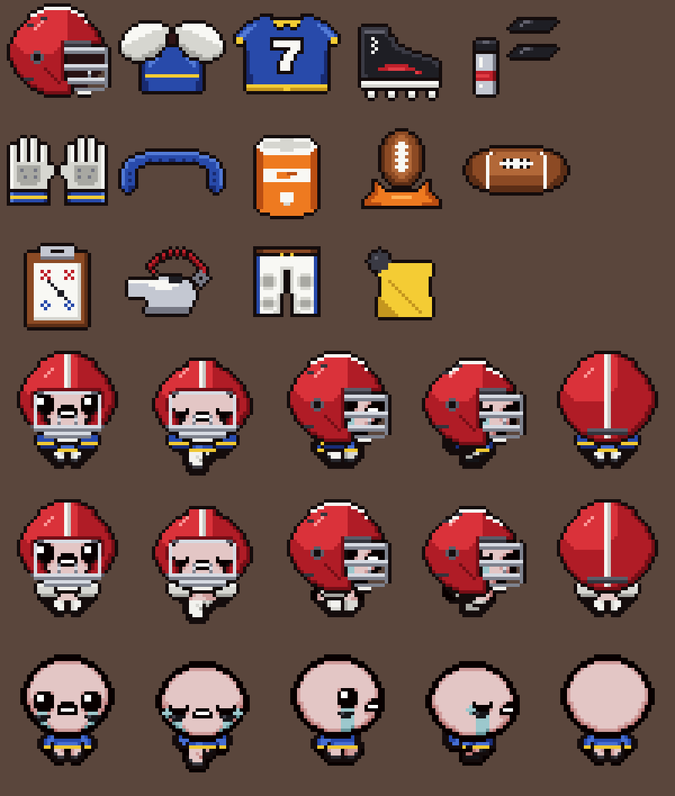

# Gridiron

A mod for **The Binding of Isaac: Repentance+** (all DLC) that adds American football gear.
None of the items replaces a vanilla item, and none is just cosmetic: each one has its own mechanic.
It uses only the vanilla Lua API, so REPENTOGON is **not** required.



## Items

| Item | Type | Pools | What it does |
|---|---|---|---|
| **Football Helmet** | Passive (Q3) | Treasure | **Tackle:** run in a straight line for ~1s and Isaac starts glowing. Running into enemies then deals 3× damage + 5, knocks them back hard and confuses them. You take no contact damage while tackling. **Facemask:** 50% chance to block enemy shots that hit you from the direction you're facing. |
| **Shoulder Pads** | Passive (Q2) | Treasure, Shop | 25% chance to **deflect** enemy shots back so they hit enemies. Taking damage sets off a **shockwave** that shoves enemies away and destroys nearby shots. With the Helmet, every tackle also sets off a smaller shockwave. |
| **Team Jersey** | Passive (Q2) | Treasure, Golden Chest | You get a **jersey number** (1–99) for the run. Every N shots (N = 3–9, set by your number) you throw a spiraling **football**: 2× damage, piercing, spectral. **Pre-snap:** enemies freeze briefly when you enter a room. |
| **Football Cleats** | Passive (Q2) | Treasure, Shop | +0.2 Speed. Running **10 yards** in an uncleared room earns a **First Down**: +0.5 Damage until you leave the room (max 4 per room). |
| **Eye Black** | Passive (Q2) | Treasure, Shop | +1 Luck. Tears do up to **+50% damage the farther they travel**. Makes you immune to **Curse of Darkness**. |
| **Receiver Gloves** | Passive (Q2) | Treasure | When you're **not shooting**, 35% chance to **catch** an enemy shot instead of getting hit (hold up to 3, shown above your head). Each shot you fire throws one caught ball back as a **football**: 1.5× damage, piercing, spectral. |
| **Mouthguard** | Passive (Q2) | Treasure, Shop | The **first hit each room** that deals a full heart or more deals **half a heart less**. Makes you immune to **fear** and **confusion**. |
| **Kicking Tee** | Active, 4 charges | Treasure | **Punt** a football in the direction you're aiming. It sails over rocks and pits and **explodes on landing** for 40 + 4× your damage, without hurting you. If the blast kills an enemy, that's a **field goal: 3 pennies**. |
| **Pigskin** | Active, 3 charges | Treasure, Shop | Throw a **fumble** that stays on the ground for 5 seconds. Non-boss enemies **scramble toward it** and get confused. **Recover it** for a **Touchdown**: +1 Damage until you leave the room. |
| **Padded Pants** | Trinket | Trinket pool | 25% chance to ignore damage from touching enemies (golden or Mom's Box raises it, up to 60%). |

### Set bonus: Suited Up
Hold **3 or more** of the seven wearable gear items (all the passives above) to get **Suited Up**: +1 Damage, and the Helmet's tackle winds up twice as fast.

## Installing
1. Download `gridiron-vX.Y.Z.zip` from the [latest release](https://github.com/bulmaspanties/tboifbm/releases/latest).
2. Unzip it into your Isaac `mods` folder, so you end up with `mods/gridiron/metadata.xml`. On Steam/Windows that's
   `C:\Program Files (x86)\Steam\steamapps\common\The Binding of Isaac Rebirth\mods`.
3. Launch the game and turn on **Gridiron** in the Mods menu.
4. To test, spawn the items from the debug console (`~`), for example `giveitem Football Helmet` or `giveitem t Padded Pants`.

### Making a release
Bump `<version>` in `metadata.xml` and push to `main`, then run the **Release** workflow from the Actions tab (or push a matching `v*` tag).
The Release workflow runs the smoke test, builds the zip with `tools/package.py` and publishes it.

If **External Item Descriptions** is installed, every item shows its description.

## Costumes
Isaac wears what he picks up: the helmet (with facemask) and eye black on his head, jersey and/or shoulder pads on his torso, and pants and/or cleats on his legs.
Pieces that share a body layer come in combined variants, and `main.lua` swaps in the right one as you collect gear.

## Layout
```
metadata.xml                    mod manifest
main.lua                        all item logic (tuning values in the Cfg table at the top)
content/items.xml               item definitions
content/itempools.xml           pool placement
content/costumes2.xml           worn costumes (item-linked + null costumes)
resources/gfx/items/...         item and trinket sprites (32x32)
resources/gfx/characters/...    costume .anm2 files and sheets
resources/gfx/tears/...         football tear spiral strip
tests/smoke_test.lua            runs main.lua against a mock of the Isaac API
tools/make_sprites.py           renders item/tear sprites from editable pixel maps (needs Pillow)
tools/make_costumes.py          generates costume sheets + .anm2 on top of Isaac's rig (needs Pillow)
```

## Testing
`tests/smoke_test.lua` loads `main.lua` against a mock of the game's Lua API and runs every item through its callbacks.
It also checks that item names, costume paths and sprite/animation paths match the XML and the files on disk.
Run it from the repo root with Lua 5.3 or newer:
```
lua tests/smoke_test.lua
```
It catches typos, nil errors and broken wiring. Balance and game feel still need a real playtest.

## Roadmap
- Playtest and balance pass (tackle wind-up, yard distance, kick damage)
- Unique costume for Suited Up
- Character-specific costume tweaks (Isaac's rig is the base; other characters may need adjustments)
